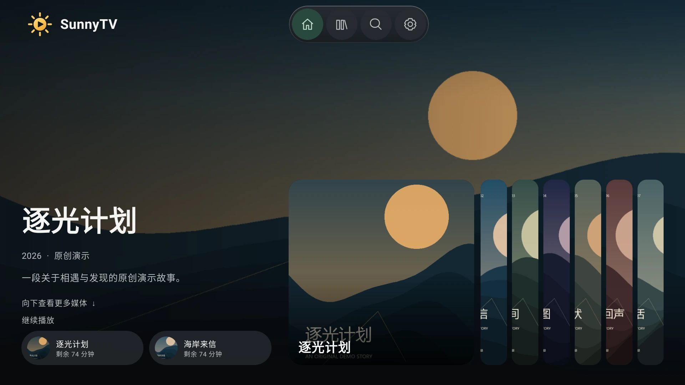
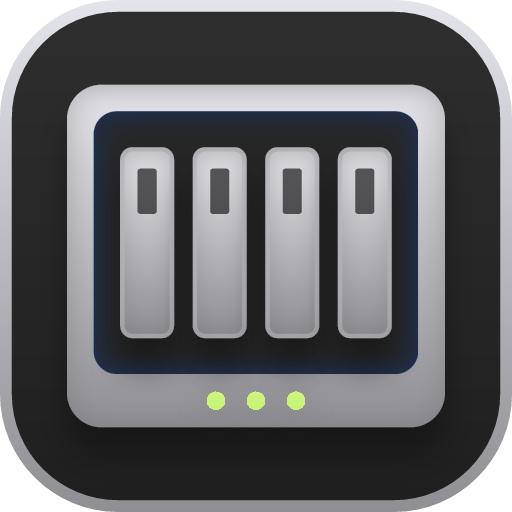
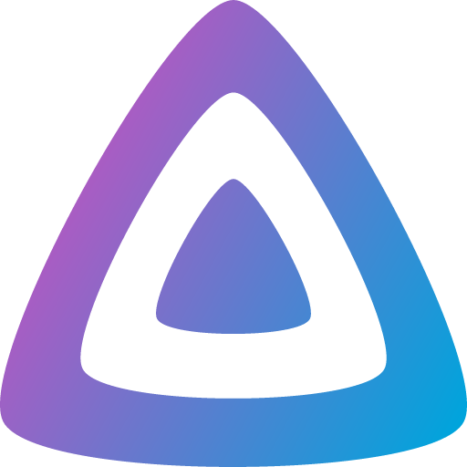
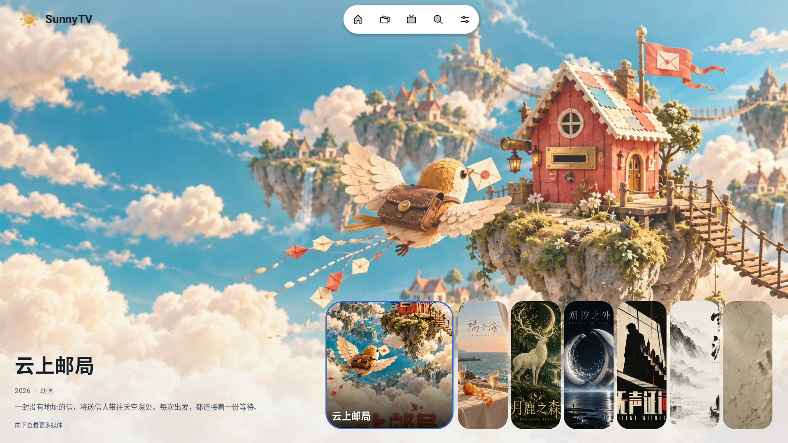
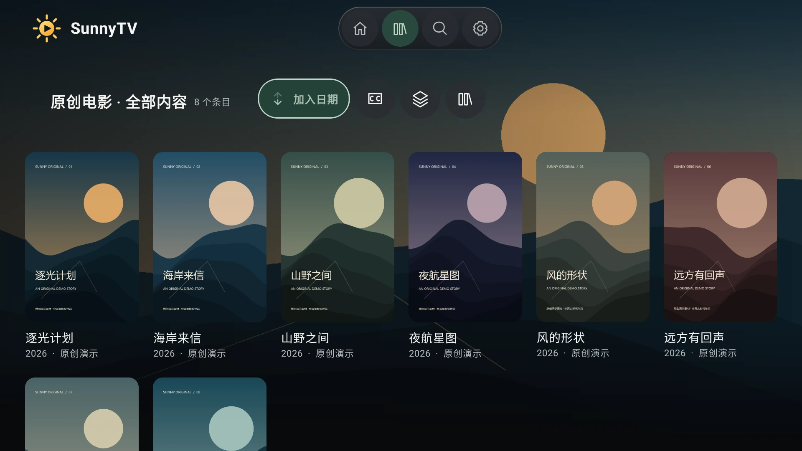
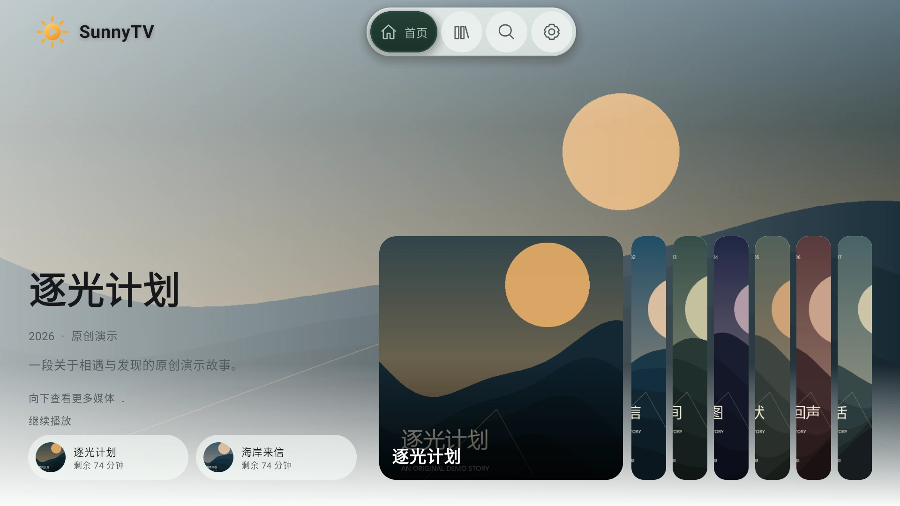

# SunnyTV

**精致入眼，流畅入戏。**

让自己的片库，好看，也好用。SunnyTV 是适用于 Android TV、手机和平板的原生影音客户端：连接自己的媒体服务，在同一套界面浏览收藏、挑选影片、接着上次的进度看。

**当前正式版：1.1.29** · 16 种质感 · 4 套图标 · 自由蒙版 · 一镜到底

[下载最新版 APK](https://github.com/xudong7587/SunnyTV-releases/releases/latest) · [官方网站](https://sunnytv.dunn.fun/) · [版本记录](https://github.com/xudong7587/SunnyTV-releases/releases) · [问题反馈](https://github.com/xudong7587/SunnyTV-releases/issues) · [请作者喝杯咖啡](#support)

1.1.29 /113 将首页「继续播放」横条放在「我的媒体库」下方，沿用原开关，有无 Banner 均可展示，最多展示 32 条近期可续播条目。上下换行改为先平滑滚动，再展开新行的焦点卡片，并保留连按、快速反向与返回焦点。

Banner 方向也已统一：手机竖屏时背景用竖图、前景方块与细条用横图；手机横屏和 TV 时背景用横图、方块与细条用竖图。缺少对应方向图片时显示背景或占位，不用反向素材替代。[查看 1.1.29 完整发行说明](https://github.com/xudong7587/SunnyTV-releases/releases/tag/v1.1.29)。正式版沿用已验收的原签名包，已安装 `SunnyTV-v1.1.29-4.apk` 的用户无需重复升级。

1.1.27 修复首页快速返回时的焦点恢复，背景优先使用合适的横图，并增大媒体格式标签和常用播放图标。符合条件的原画渐进式直放剧集，会在当前集片尾且缓冲、内存条件允许时，提前准备下一集约 5 秒的编码媒体内容，减少换集等待。预缓冲取决于来源、网络和设备支持，失败时仍按正常流程播放，不保证无缝切集。

1.1.26 在首页 Banner 和播放资源卡片展示媒体格式标签。标签支持预载和五档大小实时预览。可为媒体单独设置默认字幕，背景蒙版也可选择跟随动态取色。

## 接上媒体库，好内容就在眼前

| 接入方式 | 在 SunnyTV 中体验 |
| --- | --- |
|  **绿联云 · 官方合作** | 连接绿联影视中心，原生浏览电影、剧集与详情，选好就播放。 |
|  **Emby** | 沿用服务端的海报、媒体信息与观看进度，继续熟悉的追剧节奏。 |
|  **Jellyfin** | 接入自己的媒体库，从海报墙选片，到原生播放器入戏。 |
|  **飞牛影视** | 在同一套界面浏览自己的电影、剧集和详情。 |
| **STRM · MediaIndex** | 通过媒体服务连接 STRM 原画；搭配 [MediaIndex](https://github.com/xudong7587/media-index-deploy)，原生选择片源已生成的云端清晰度，优先直连云端 CDN。 |
| **电视直播** | 导入自己提供的 HTTP(S) M3U / M3U8 频道列表；应用不内置直播源。 |

## 让界面，也有你的品味

- **16 种质感**：柔软浮雕、清晰默认、纸页档案、亚麻织纹、液态玻璃、雾面玻璃、极光玻璃、深浅渐层、缎光瓷面、精致描边、拉丝金属、陶土哑光、大理石、霓虹暗夜、纸片拼贴、雾面色场。
- **颜色随心**：7 种单色、6 套多色和自定义配色；Monet 可从系统、主题色或 Banner 海报生成一整套色阶。深浅模式、质感与配色独立选择。
- **背景刚刚好**：全局与设置页蒙版独立保存；顶部、底部羽化各自调节范围与不透明度。六项参数均可在 0–100% 调整，触摸实时预览，遥控器可按 1% 精细调节。
- **4 套完整图标**：圆润线条、主题双色、圆润实心、柔圆线条，每套 60 枚，贯穿导航、菜单与播放器。四套图标在外观设置中并排比较，播放预览使用统一大小的按钮；主题双色仅在聚焦时点亮主题色，离开焦点即恢复黑白色阶。 默认使用圆润实心，已有保存的主题选择继续保留。
- **文字读着舒服**：手机扫码即可通过同一局域网上传 TTF、OTF、TTC；界面与字幕分别选择，也可从本地文件或 U 盘导入，按习惯调整大小、字幕描边与位置。

高开销材质按设备能力与性能设置启用，不同设备的可用选项和效果可能不同。[在官网试试质感、蒙版与图标示意](https://sunnytv.dunn.fun/#personalization)。

## 从海报到详情，一镜到底

点开的海报自然展开，详情顺势接入；返回时回到原来的卡片与焦点。打开 **设置 → 性能 → 页面转场**，选择「一镜到底 / 无缝转场」，五档动画速度独立设置。

[观看 1080p 无声视频](https://sunnytv.dunn.fun/#motion) · [下载 MP4](assets/one-take.mp4)

1.1.22 正式包在 Android 模拟器内以正常 1× 动画速度原生录制，1080p、无配乐，使用清晰的原创虚构片库素材。低负载模式回退淡入淡出，关闭动画或减少动态效果时停用转场；实际流畅度依设备而异。

## 原生播放，操作顺手

音轨、字幕、倍速与画面比例集中在原生控件里，所有质感的播放按钮都采用无外框、无底板的图标；支持 STRM 按需读取、高码率预缓冲和进度续播，实际播放能力取决于设备与来源。电视遥控器有明确的方向导航、焦点与返回位置记忆，手机和平板也能直接触摸操作。

搭配 SP658E 灯带，可调整画面同步、固定色、亮度与灯珠定位，让色彩延伸到屏幕之外；同步能力依片源与设备而异。

| 海报墙 | 浅色主题 |
| --- | --- |
|  |  |

以上界面截图使用原创虚构片名和海报，不含用户媒体库。实际界面随版本、设备和设置而变化。[品牌图标来源与归属](assets/ASSETS.md)。

## 安装与升级

1. 使用 Android 7.0 或更高版本的电视、盒子、手机或平板。
2. 打开[最新版下载页](https://github.com/xudong7587/SunnyTV-releases/releases/latest)，在 Assets 中下载 `.apk` 文件。
3. 按系统提示允许该安装来源，安装后添加自己的媒体服务或频道列表。

**从 1.0.9 或更早版本升级时，请先手动下载一次 1.1.0 或更高版本，直接覆盖安装。** 从 1.1.0 起，应用内升级使用本仓库；官方签名安装包可覆盖升级，无需先卸载。

每个版本提供三个附件：APK 安装包、`BUILD_INFO.txt` 版本信息、`SHA256SUMS.txt` 校验文件。GitHub 自动显示的 Source code 压缩包不包含应用源码，请下载 APK。

## 使用与反馈

SunnyTV 不提供影视资源，需要使用自己的服务器、账号及有权访问的媒体。不同来源的收藏、进度和播放能力以对应服务支持情况为准。

遇到问题可以到 [Issues](https://github.com/xudong7587/SunnyTV-releases/issues) 描述应用版本、设备型号、Android 版本及复现步骤。截图和日志请先隐藏服务器地址、账号、令牌及私人媒体信息。

本仓库用于发布安装包、更新说明与收集反馈。更多展示请查看[官方网站](https://sunnytv.dunn.fun/)。

## 请作者喝杯咖啡

如果 SunnyTV 让你的看片时光更舒服，欢迎请作者喝杯咖啡，支持持续打磨。感谢每一份心意。

微信扫一扫 · 自愿支持，量力而行

